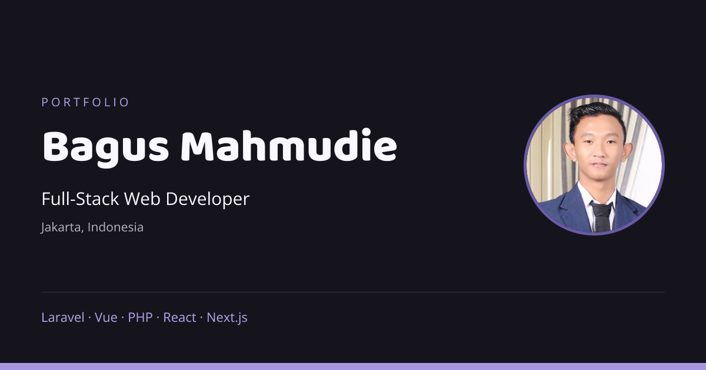

# Bagus Mahmudie — Portfolio

Portofolio pribadi **Bagus Mahmudie**, Full-Stack Web Developer berbasis di Jakarta. Menampilkan profil, layanan pengembangan web, teknologi yang digunakan, dan 19 proyek website maupun aplikasi.

**[Buka Website](https://bagus-mahmudie-portfolio.vercel.app/)** · [GitHub](https://github.com/bagus-mahmudie) · [LinkedIn](https://www.linkedin.com/in/bagus-mahmudie/)

[](https://bagus-mahmudie-portfolio.vercel.app/)

## Fitur

- Tampilan responsif untuk desktop, tablet, dan ponsel.
- Tema light/dark dengan tombol bergaya lampu dan penyimpanan preferensi tema.
- Konten bahasa Indonesia dan Inggris.
- Carousel teknologi dengan animasi berulang, pause saat hover/focus, dan dukungan reduced motion.
- Galeri 19 proyek dengan filter website/aplikasi, tombol tampilkan lainnya, tautan repository, dan website yang tersedia.
- Background kartu dari preview proyek serta logo yang disesuaikan dengan tema.
- Form kontak yang membuka Gmail compose berisi nama, email, dan pesan pengunjung.
- Tautan GitHub, LinkedIn, WhatsApp, dan email; tombol kembali ke atas.
- Metadata SEO, canonical, Open Graph, Twitter Card, JSON-LD, robots, dan sitemap.

> Form kontak tidak mengirim email otomatis. Pengunjung memeriksa pesan dan menekan **Kirim** di Gmail.

## Teknologi

| Bagian | Teknologi |
| --- | --- |
| Framework | Next.js 16 App Router |
| UI | React 19, TypeScript |
| Styling | Tailwind CSS 4, CSS Modules, CSS custom |
| Tema | next-themes |
| Ikon | Lucide React dan aset SVG lokal |
| Font | Baloo Paaji dan Open Sans, disajikan lokal |
| Hosting | Vercel |

Versi dependency lengkap tersedia di [package.json](package.json). Konfigurasi proyek menggunakan Turbopack dan integrasi `@tailwindcss/turbopack`.

## Menjalankan secara lokal

Prasyarat: **Node.js 20.9 atau lebih baru** dan npm. Gunakan versi Node.js yang masih didukung dan cocok dengan pengaturan deployment.

```sh
git clone https://github.com/bagus-mahmudie/my-portfolio.git
cd my-portfolio
npm ci
npm run dev
```

Buka [localhost:3000](http://localhost:3000). Jika repository privat, akun GitHub yang digunakan untuk clone harus mempunyai akses.

Konfigurasi environment tidak wajib untuk pengembangan lokal. Jika diperlukan, salin [.env.example](.env.example) menjadi `.env.local`, lalu isi variabel yang sesuai. Jangan commit file environment yang berisi token.

## Perintah

| Perintah | Fungsi |
| --- | --- |
| `npm run dev` | Menjalankan server pengembangan |
| `npm run lint` | Memeriksa kode dengan ESLint |
| `npm run check:seo` | Memeriksa konfigurasi domain, indexing, metadata, robots, dan sitemap |
| `npm run build` | Membuat production build dan memeriksa TypeScript |
| `npm start` | Menjalankan hasil production build |
| `npm run generate:social` | Membuat ulang gambar preview sosial 1200 × 630 |

Validasi sebelum menerbitkan perubahan:

```sh
npm run lint
npm run check:seo
npm run build
```

## Struktur proyek

```text
public/
  fonts/                     Font lokal dan lisensi
  images/
    project-backgrounds/     Background kartu proyek
    social/                  Ikon media sosial
    tech/                    Logo teknologi
  social-preview.png         Preview untuk berbagi tautan
scripts/
  check-seo.mjs              Pemeriksaan konfigurasi SEO
  generate-social-preview.mjs
src/
  app/
    globals.css             Gaya utama
    layout.tsx              Layout, metadata, dan JSON-LD
    page.tsx                Halaman portofolio
    robots.ts               Aturan crawling
    sitemap.ts              Sitemap
  components/               Carousel, tema, bahasa, dan kontrol halaman
  data/
    projects.ts             Data proyek
    translations.ts         Konten ID/EN
    presentation.ts         Konten presentasi ID/EN
    project-image-sizes.json Ukuran intrinsik logo
  lib/
    seo.ts                  Konfigurasi domain dan metadata
```

## Mengubah konten

| Kebutuhan | Lokasi |
| --- | --- |
| Menambah atau mengubah proyek | [src/data/projects.ts](src/data/projects.ts) |
| Mengubah konten ID/EN | [translations.ts](src/data/translations.ts) dan [presentation.ts](src/data/presentation.ts) |
| Mengubah daftar teknologi | [TechCarousel.tsx](src/components/TechCarousel.tsx) |
| Mengatur jarak dan animasi carousel | [TechCarousel.module.css](src/components/TechCarousel.module.css) |
| Mengubah gaya dan tampilan kartu | [globals.css](src/app/globals.css) |
| Mengganti logo atau background | `public/images/` dan `public/images/project-backgrounds/` |
| Mengubah metadata dan profil SEO | [src/lib/seo.ts](src/lib/seo.ts) |

Nama aset proyek mengikuti slug repository. Saat menambah proyek, periksa juga pemetaan `imageFor`, `backgroundFor`, daftar `projectBackgrounds` di `page.tsx`, serta ukuran gambar dalam `project-image-sizes.json`. Beberapa logo memakai varian khusus untuk light/dark mode.

## Deployment di Vercel

Website produksi: **https://bagus-mahmudie-portfolio.vercel.app/**

1. Hubungkan repository ini melalui **Add New → Project** di Vercel.
2. Pilih preset **Next.js** dan Root Directory `./`.
3. Biarkan pengaturan build/install/output mengikuti preset proyek.
4. Pastikan **Automatically expose System Environment Variables** aktif.
5. Klik **Deploy**. Commit yang di-push ke branch produksi akan memicu deployment berikutnya jika integrasi Git aktif.

### Environment variables

| Variabel | Keterangan |
| --- | --- |
| `NEXT_PUBLIC_SITE_URL` | Opsional di Vercel. Override domain utama untuk canonical dan sitemap, misalnya `https://bagus-mahmudie-portfolio.vercel.app`. Gunakan origin tanpa path, query, atau fragment. |
| `VERCEL_PROJECT_PRODUCTION_URL` | Disediakan Vercel; digunakan otomatis jika `NEXT_PUBLIC_SITE_URL` kosong. Tidak perlu diisi manual. |
| `GOOGLE_SITE_VERIFICATION` | Opsional. Token verifikasi HTML Google Search Console, bukan seluruh tag meta. |

Jika memakai domain sendiri, isi `NEXT_PUBLIC_SITE_URL` pada environment **Production**, kemudian redeploy. Perubahan environment baru berlaku pada build/deployment berikutnya.

## SEO dan indexing

- Canonical mengarah ke domain produksi yang dikonfigurasi.
- Deployment Production dengan domain valid mengaktifkan indexing.
- Preview, development, dan build lokal tanpa domain menggunakan `noindex`; sitemap tidak memuat URL produksi pada lingkungan tersebut.
- JSON-LD menjelaskan profil melalui `Person`, `WebSite`, dan `ProfilePage`.
- Bahasa ID/EN menggunakan satu URL dengan toggle di klien, bukan route bahasa terpisah.
- Galeri proyek tetap memakai filter dan tombol tampilkan lainnya; tidak mempunyai halaman detail proyek tersendiri.

Endpoint produksi:

- [robots.txt](https://bagus-mahmudie-portfolio.vercel.app/robots.txt)
- [sitemap.xml](https://bagus-mahmudie-portfolio.vercel.app/sitemap.xml)

Untuk mengajukan indexing, verifikasi website di Google Search Console lalu kirim sitemap. Deployment dan metadata tidak otomatis menjamin posisi atau waktu kemunculan di hasil pencarian.

## Referensi dan atribusi

Desain mengadaptasi Meyawo oleh DevCRUD, dengan penyesuaian komponen React, tema, dan konten pribadi. Referensi carousel dan kontrol tema, sumber logo, serta atribusi aset dicatat di [DESIGN-SOURCES.md](DESIGN-SOURCES.md). Lisensi font tersedia di `public/fonts/`.

Logo dan identitas proyek merupakan milik pemilik merek masing-masing. Lihat [AUDIT.md](AUDIT.md) untuk rincian audit file, SEO, dan batas verifikasi.

## Kontak

- Email: [bagusmahmudie@gmail.com](mailto:bagusmahmudie@gmail.com)
- WhatsApp: [+62 812-5404-7573](https://wa.me/6281254047573)
- GitHub: [@bagus-mahmudie](https://github.com/bagus-mahmudie)
- LinkedIn: [Bagus Mahmudie](https://www.linkedin.com/in/bagus-mahmudie/)
